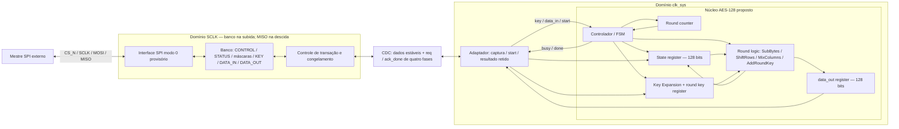
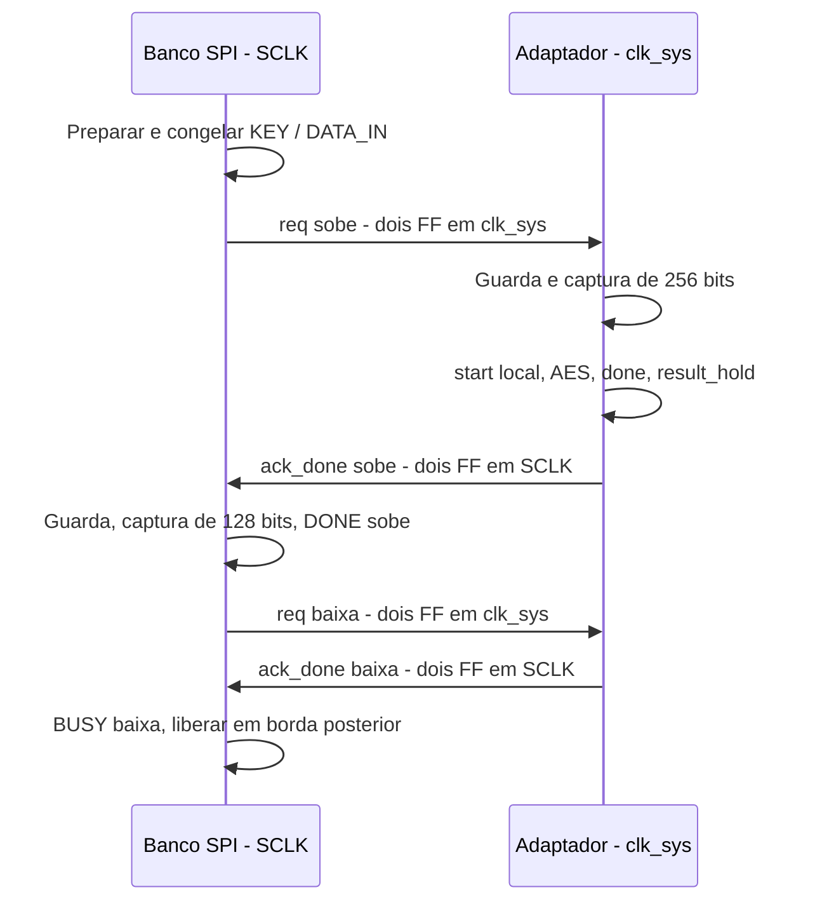

# Arquitetura v1.0 — Acelerador AES com interface SPI

Data: 09/10/2026. Entrega: Semana 2. **Status: proposta para defesa; aprovação do instrutor e revisão com o verificador pendentes.** Não é uma implementação final.

## 1. Objetivo, escopo e classificação

Definir um contrato simples e verificável entre mestre SPI, armazenamento, CDC e núcleo AES, preparando o datapath da Semana 3 e a integração posterior. Esta versão contém arquitetura, interfaces e pseudocódigo conceitual. O único RTL executável continua sendo o smoke XOR da Semana 1.

Usamos quatro categorias:

| Categoria | Significado |
|---|---|
| **R — requisito** | Pedido explícito do projeto/entrega ou regra normativa do algoritmo |
| **D — decisão arquitetural provisória** | Escolha de engenharia desta proposta, ainda sujeita à confirmação do instrutor e à validação aplicável |
| **H — hipótese** | Condição de trabalho ainda sem confirmação da especificação funcional |
| **P — pendência** | Informação, aprovação ou evidência que ainda falta |

**R:** acelerador AES com SPI e futura investigação de baixo consumo; nesta semana definir blocos, interfaces, clocks/reset, CDC, microarquitetura, mapa, documento, defesa e apresentação ao verificador. O aceite exige arquitetura aprovada pelo instrutor. Não implementar AES ou SPI funcional nesta etapa.

**H:** AES-128 é adotado como baseline arquitetural provisório para permitir o desenvolvimento, sujeito à confirmação da especificação funcional do instrutor.

**H:** somente a primitiva de cifragem de um bloco por comando, sem decifragem, padding, autenticação ou modo criptográfico acrescentado. Operações independentes de bloco não constituem uma escolha oficial de modo ECB para mensagens.

**P:** P01–P13 continuam rastreados em [pendencias.md](../spec/pendencias.md). As hipóteses acima precisam de confirmação antes de congelar a interface funcional.

Nas seções operacionais, “usa”, “aceita” e “deve” descrevem o **contrato condicional da baseline provisória**, não uma aprovação já recebida. AES-128, somente cifragem, SPI modo 0, reset ativo baixo, organização de 16 + 4 S-boxes e geração adiantada de round keys **não são requisitos oficiais confirmados**. As regras normativas do AES aplicam-se à variante que vier a ser aprovada; não escolhem essa variante pelo instrutor.

## 2. Base e referências

O [diagnóstico](../reports/semana_02_diagnostico.md) registra a leitura da Semana 1 antes das alterações. Sua documentação histórica, RTL, testbench, Makefile e scripts permanecem preservados. Esta versão transforma alternativas previamente abertas em propostas explícitas, sem atribuir essas escolhas à Semana 1.

O [FIPS 197-upd1](https://nvlpubs.nist.gov/nistpubs/FIPS/NIST.FIPS.197-upd1.pdf), seções 3.4, 5.1 e 5.2, define o algoritmo: blocos de 128 bits; no AES-128, dez rodadas e onze chaves de rodada; adição de chave inicial; nove rodadas completas; última rodada sem MixColumns. A expansão e a correspondência dos bytes precisam respeitar o padrão. O FIPS não fixa os ciclos, a quantidade de S-boxes nem o barramento deste IP.

A [referência da Analog Devices](https://www.analog.com/en/resources/analog-dialogue/articles/introduction-to-spi-interface.html), seções Interface e Clock Polarity and Clock Phase, fundamenta os quatro fios e as bordas dos modos SPI. Endereços, opcodes e regras abaixo são decisões próprias do projeto.

Como apoio para CDC, a [documentação AMD de handshake de barramento](https://docs.amd.com/r/2023.2-English/ug1344-versal-architecture-libraries/XPM_CDC_HANDSHAKE) exige completar o handshake antes de nova transferência e verificar estabilidade/amostragem dos dados. Não adotamos a macro de fornecedor: o protocolo transacional abaixo é uma proposta própria, cuja implementação e análise física ainda serão verificadas.

## 3. Decisões resumidas e dependências

| ID | Categoria | Escolha / condição |
|---|---|---|
| D01 | D sob H | Núcleo iterativo de 128 bits, uma rodada por ciclo, uma operação por vez |
| D02 | H — baseline provisório | AES-128, somente cifragem da primitiva; confirmar P01/P02/P13 |
| D03 | D | Acessos de 32 bits completos, endereços em bytes, alinhamento de quatro bytes |
| D04 | D — provisória | Round key corrente de 128 bits; próxima chave gerada em paralelo, um ciclo adiantada; confirmar uso e validar por síntese |
| D05 | H arquitetural / D provisória | 16 S-boxes no State + 4 no key schedule; preferência por tabela combinacional, a validar por síntese |
| D06 | D | SCLK e clk_sys independentes; banco e status visível no domínio SPI |
| D07 | D — provisória | rst_n externo ativo baixo; assert assíncrono/deassert local; polaridade e partida pendentes em P06 |
| D08 | D | Banco congelado + handshake de quatro fases; resposta atômica com resultado |
| D09 | D | BUSY reserva a transação inteira; DONE sticky; erro de uso visível no banco |
| D10 | D | STATUS/CONTROL/VALID_MASK e janelas separadas de KEY/DATA_IN/DATA_OUT |
| D11 | D — baseline provisório | SPI modo 0, MSB primeiro, frame fixo de 48 clocks, sem burst; confirmar P03/P05 |
| D12 | D | Máscaras de completude; nova chave exige quatro escritas; plaintext consumido no START |

Os [ADRs](decisoes_semana_02.md) detalham contexto, alternativas e impactos. Não há metas numéricas de frequência, área, potência ou MTBF assumidas. A escolha pode ser revista quando P01–P04 e P11–P12 forem respondidas.

## 4. Arquitetura de alto nível

O mestre escreve o banco por SPI, inicia uma transação e consulta status. O banco reúne palavras recebidas em instantes distintos. Ao aceitar START, congela chave e plaintext, eleva BUSY e publica uma requisição persistente. O adaptador de sistema captura o conjunto estável, aciona o núcleo uma única vez e devolve o resultado por confirmação persistente. A conclusão só se torna visível no banco quando os 128 bits de saída foram capturados juntos.



As setas agrupam canais; a direção de cada sinal está formalizada a seguir. O retorno não sincroniza DATA_OUT bit a bit e não expõe diretamente o State interno.

### 4.1 Interfaces entre blocos

Nomes conceituais, sem novos módulos RTL nesta entrega. Todos os pulsos desta tabela são locais ao domínio indicado.

| Origem → destino | Sinais e larguras | Domínio / contrato |
|---|---|---|
| Pinos → SPI | sclk, cs_n, mosi: 1 cada | Modo 0; MOSI amostrado na subida com CS_N baixo |
| SPI → pino | miso_o, miso_oe: 1 cada | Dados mudam na descida; OE desabilitado com CS_N alto ou reset; tri-state apenas no pad/top apropriado |
| SPI → banco | wr_commit: 1, addr: 8, wdata: 32 | Na 48ª subida; palavra inteira, no máximo uma escrita por frame |
| SPI ↔ banco | rd_snapshot: 1, addr: 8, rdata: 32 | Snapshot após a 16ª subida; shift register mantém os 32 bits até fim da leitura |
| Banco → adaptador | key_hold: 128, din_hold: 128, req: 1 | Dados congelados; req passa por sincronizador no sistema |
| Adaptador → banco | result_hold: 128, ack_done: 1 | Resultado registrado antes de ack_done; ack passa por sincronizador SPI |
| Adaptador ↔ núcleo | Interface da seção 10 | Somente clk_sys; nenhuma entrada SPI chega diretamente ao núcleo |
| Controle SPI → banco | lock/busy: 1, capture_result: 1 | Atualiza BUSY e captura 128 bits/DONE no mesmo domínio |
| Reset externo → todos | rst_n: 1 | Assert comum; liberação por fase/domínio conforme seção 6 |

wr_commit/rd_snapshot descrevem eventos nas bordas; a futura organização modular deve respeitar esses instantes, sem acrescentar inadvertidamente um ciclo de serialização. Combinacionalmente, o endereço deve estar decodificado a tempo do snapshot, incluindo o último bit recebido.

## 5. Clocks e temporização

**D:** clk_sys é o clock de sistema fornecido ao IP; comanda adaptador, FSM, datapath e key schedule. SCLK é fornecido pelo mestre externo e pode pausar. Não há PLL, divisor ou relação de fase/frequência presumida entre eles. A implementação inicial mantém clk_sys ativo durante a operação.

Há dois domínios assíncronos porque há armazenamento comandado por cada clock. O lançamento de MISO na descida de SCLK é uma fase relacionada à subida, não um terceiro clock assíncrono. Os caminhos subida→descida precisam cumprir meio período efetivo, incluindo duty cycle, setup, jitter e skew.

MOSI e CS_N seguem temporização relativa a SCLK. Não são entradas genéricas de clk_sys. Sobreamostrar SPI em clk_sys foi rejeitado nesta baseline porque dependeria de limites de frequência e largura de pulso que ainda não foram fornecidos.

**P04/P12:** especificar períodos mínimos, duty cycle, jitter, setup/hold de MOSI/CS_N, atraso de MISO, largura mínima de reset e meta de confiabilidade. Criar restrições de clocks independentes e tratamento específico dos caminhos de dados estáveis; não mascarar todo CDC por um false path indiscriminado. Não declarar timing fechado nesta entrega.

## 6. Reset e inicialização

**D07 — decisão arquitetural provisória:** porta externa `rst_n`, ativa baixa, sujeita à confirmação do instrutor (P06). Sua polaridade não deriva de CS_N. O reset aborta qualquer operação e zera dados, máscaras, flags, registradores do núcleo, req/ack e estados dos adaptadores. Após reset, resultados anteriores são inválidos e o mestre recarrega os operandos.

Cada domínio/fase usa um sincronizador de liberação de reset com dois estágios como ponto de partida: clk_sys na subida, SCLK na subida e SCLK na descida para o transmissor MISO. Assert é assíncrono em todos; deassert ocorre nas bordas locais. Profundidade final, distribuição e recovery/removal dependem da tecnologia.

| Estratégia | Vantagem | Limitação |
|---|---|---|
| Reset inteiramente síncrono | Integração simples com análise temporal local | Não atua em registradores cujo clock parou |
| Reset inteiramente assíncrono, liberação direta | Atua sem clock | Liberação próxima à borda pode violar recovery/removal e desalinhar FSMs |
| Reset comum assíncrono / deassert sincronizado por domínio, baseline provisório | Aborta as duas pontas mesmo com SCLK parado; controla liberação local | Sem SCLK, SPI pode permanecer em reset; exige análise de reset e células adequadas |
| Resets separados por domínio | Permitem controlar cada domínio independentemente | Não criam bordas para liberar SPI; exigem coordenação, invalidação da transação e recuperação para evitar pedido/resposta fantasma |
| Exigir clock externo durante inicialização, condição da baseline | Permite liberar os resets SPI sem clock adicional no IP | Depende da capacidade do mestre; não é solução garantida pelo acelerador nem alternativa elétrica ao sincronizador |

**Risco R05 — alto:** deassert sincronizado no SPI depende de bordas de SCLK. Se SCLK permanecer parado, o domínio pode permanecer em reset indefinidamente, mesmo com rst_n externo já em 1. Ainda não está confirmado se o mestre consegue fornecer essas bordas; portanto o risco permanece aberto.

**Condição de partida proposta, pendente de confirmação:** manter CS_N alto durante reset e depois fornecer pelo menos quatro períodos completos de SCLK com CS_N alto, e pelo menos quatro ciclos de clk_sys após liberar rst_n, antes do primeiro comando. Esse número é um protocolo provisório para os dois estágios e a retomada local, não uma exigência oficial nem prova de timing. Funciona somente se o mestre fornecer os clocks nas condições previstas. Se não puder, revisar arquitetura/reset e protocolo de partida; não simplesmente retirar os sincronizadores ou supor liberação pelo tempo decorrido.

**Pergunta obrigatória ao professor:** quem fornece as bordas de SCLK para liberar reset, o mestre pode gerá-las com CS_N alto e qual recuperação é exigida caso os domínios tenham resets separados?

Não há reset independente de um lado do handshake nesta baseline. Reset global deve alcançar os dois lados mesmo que algum clock esteja parado. Reset unilateral ou desligamento de domínio exigirá recuperação explícita em revisão futura; caso contrário, um nível pendente pode parecer uma transação nova ou uma confirmação antiga.

CS_N alto aborta **somente o parser e o deslocamento do frame**, inclusive sem novos clocks, e desabilita MISO. Não limpa banco, flags, máscaras, sincronizadores nem handshake. A futura lógica de framing pode usar clear assíncrono local por CS_N; sua liberação deve cumprir recovery/removal até a primeira borda. Não se deve colocar dois FF de atraso em CS_N e perder os primeiros bits de um frame modo 0. CS_N não é um clock nem o reset global do IP.

## 7. CDC: contrato completo da transação

### 7.1 Problema e alternativas

Metastabilidade é um fenômeno físico associado à amostragem próxima a uma transição. Dois FF em série reduzem a chance de propagá-la; não eliminam o risco. Sincronizar individualmente bits de um barramento pode entregar bits de instantes diferentes. A coerência vem de congelar o dado e coordenar a captura, não da mera quantidade de FF por bit.

| Alternativa | Uso / restrição | Avaliação para este IP |
|---|---|---|
| Dois FF de nível de 1 bit | Níveis persistentes, com MTBF analisado | Usados em req e ack_done; primeiro estágio não dirige outra lógica |
| Pulse synchronizer / alongamento | Pulso precisa permanecer observável; frequentemente requer taxa mínima ou realimentação | Pulso simples pode sumir com SCLK parado; não atravessar start/done diretamente |
| Toggle synchronizer | Evento vira mudança persistente; dois eventos antes da observação podem se cancelar | Viável com ack, mas requer controle de intervalo e fase de reset |
| Handshake req/ack | Emissor espera receptor; naturalmente limita a uma transferência | Escolhido, com confirmação retardada até o resultado estar pronto |
| FIFO de dois clocks | Absorve rajadas, múltiplos itens e backpressure | Capacidade desnecessária para um bloco por vez; ponteiros/reset/cheio/vazio ampliam prova |
| Shadow registers isolados | Separam escrita serial de operandos em uso | Armazenamento sozinho não garante CDC |
| Captura estável + handshake | Barramento retido e amostrado atomicamente sob controle sincronizado | Escolhido com congelamento do banco e resultado retido |

### 7.2 Escolha: quatro fases com resultado na confirmação

Um único slot transacional evita filas e dois mailboxes independentes. Na sequência abaixo, **origem do pedido = banco SPI (SCLK)** e **destino do pedido = adaptador (clk_sys)**. `REQ` corresponde ao sinal `req`; `ACK` corresponde a `ack_done`. Este ACK é **retardado até o resultado estar disponível**, não sobe imediatamente após capturar os operandos. Assim o mesmo handshake cobre ida e resposta. Ambos são níveis registrados, cada um sincronizado por dois FF no receptor.

1. **Preparar:** com BUSY=0 e `(req,ack_done)=(0,0)`, a origem escreve KEY/DATA_IN e completa suas máscaras.
2. **Congelar:** START admissível reserva o slot (BUSY=1), bloqueia novas escritas e mantém os valores de KEY/DATA_IN. Limpa DONE e consome somente a validade de DATA_IN.
3. **REQ sobe:** a origem registra req=1. Congelamento e subida de req podem ocorrer na mesma borda de aceitação, pois os operandos já estavam escritos e nenhum deles muda nessa borda; não se acrescenta um ciclo SPI obrigatório entre 2 e 3.
4. **Sincronizar REQ:** no destino, req atravessa dois FF em clk_sys; apenas a saída do segundo estágio alimenta o controlador.
5. **Capturar:** ao detectar req sincronizado alto, o destino entra em GUARD e espera mais uma borda clk_sys para capturar os 256 bits estáveis em key_sys/din_sys. Gera start local de um ciclo, amostrado pelo núcleo na borda seguinte. A FSM não recaptura enquanto req continuar alto.
6. **ACK sobe, após executar:** o AES calcula; o adaptador amostra done/data_out e registra result_hold. Somente na borda clk_sys seguinte registra ack_done=1, depois de um ciclo de antecedência do resultado. A espera entre 5 e 6 é intencional e distingue este protocolo de um simples ACK de recebimento.
7. **Sincronizar ACK e capturar retorno:** a origem do pedido sincroniza ack_done por dois FF em SCLK, espera uma borda adicional de guarda e captura result_hold em DATA_OUT, elevando DONE. Na resposta, o adaptador é a origem dos 128 bits e o banco SPI é o destino.
8. **REQ baixa:** na mesma borda SPI da captura de DATA_OUT, registra req=0. BUSY permanece 1; os operandos continuam congelados.
9. **Observar REQ baixo:** o destino observa req=0 depois dos mesmos dois FF em clk_sys. Isso confirma que a resposta foi capturada pelo SPI.
10. **ACK baixa:** o destino registra ack_done=0 e volta a esperar novo pedido. result_hold continua retido até outra conclusão ou reset.
11. **Liberar:** somente após observar ack_done=0 pelos dois FF em SCLK, a origem limpa BUSY. Escritas e novo START são admissíveis a partir de borda posterior com BUSY anteriormente em 0; antes disso não pode alterar o barramento.



As quatro fases são `00 → 10 → 11 → 01 → 00`, como `(req,ack_done)`. O diagrama mostra ordem causal, não clocks alinhados nem latência fixa de CDC.

| Transferência | Origem → destino | O que é sincronizado | Captura / status |
|---|---|---|---|
| KEY + plaintext, 256 bits | Banco SPI → adaptador clk_sys | Apenas req, por dois FF em clk_sys | key_sys/din_sys capturados juntos após guarda; barramento sem sincronização bit a bit |
| Ciphertext, 128 bits | result_hold em clk_sys → DATA_OUT no SPI | Apenas ack_done, por dois FF em SCLK | Captura atômica após guarda; req baixo confirma recebimento |
| Conclusão / ocupação | Evento concluído em clk_sys → controle SPI | A informação de conclusão viaja em ack_done | DONE é criado localmente após captura; BUSY é mantido pela FSM SPI até fechar handshake |
| Demais campos STATUS | Controle/máscaras SPI → leitura SPI | Nenhum CDC adicional | ERROR, KEY_READY e DATA_READY são locais; STATUS inteiro não cruza clocks |

O pulso `done` é capturado pelo adaptador em clk_sys e convertido na confirmação persistente; nem esse pulso nem `busy` interno são sincronizados diretamente para o banco. Sincronizar cada bit de KEY/DATA_IN/DATA_OUT independentemente poderia observar bits novos e antigos em uma mesma palavra, por diferenças de chegada/resolução; as cadeias não definiriam uma captura atômica comum.

`key_hold` e `din_hold` ficam estáveis desde a aceitação até BUSY voltar a zero. `result_hold` fica estável desde sua publicação até ser substituído pelo resultado de outra operação ou reset; portanto cobre toda a confirmação. Os registradores de origem não recebem escritas concorrentes durante esse intervalo. Não existe sincronizador de dois FF para cada bit dos 256/128 bits.

Os guardas e a antecedência de publicação dão margem lógica, mas **não substituem restrições físicas**. Exigir que o pior atraso do barramento, skew e setup caibam na janela mínima lançamento→captura da implementação. Um orçamento conservador inicial é inferior a um período mínimo do clock receptor, descontadas margens; deve ser especificado e verificado por direção quando as frequências forem conhecidas. A cadeia de controle também exige posicionamento/atributos de sincronização e avaliação de MTBF. Não há segurança física demonstrada somente pelo pseudoprotocolo.

### 7.3 Parada de SCLK, status e progresso

Se SCLK parar após START aceito, req e operandos permanecem estáveis, e clk_sys pode completar AES. ack_done e result_hold ficam retidos indefinidamente. Quando o mestre voltar a fornecer SCLK, o SPI captura o resultado e fecha o handshake. Sincronizadores rodam em todas as bordas de SCLK, inclusive com CS_N alto; não são habilitados por CS_N.

BUSY visível inclui CDC de entrada, cálculo, CDC de saída e fechamento. Não é cópia assíncrona de busy do núcleo. DONE é criado localmente pela captura da resposta; não é o pulso done atravessando clocks. Durante fechamento, `BUSY=1, DONE=1` é permitido: resultado já está disponível, mas o slot ainda não foi liberado.

O mestre pode gerar clocks por leituras de STATUS. Cada leitura é um snapshot e pode refletir um valor anterior à atualização; deve repetir o polling até a condição desejada. Sem retorno de clocks não existe limite de latência de parede nem garantia de progresso do lado SPI. Isso não invalida o resultado retido.

### 7.4 Invariantes a verificar no RTL futuro

- Um START aceito produz no máximo um start local e uma publicação de resultado.
- Pedido pendente implica operandos estáveis; ack_done alto implica resultado estável.
- Nenhum novo pedido antes de completar as quatro fases; nenhum pulso assíncrono usado como evento.
- DATA_OUT e DONE são atualizados atomicamente; um reset comum cancela a transação.
- Progresso depende de clocks retomarem e reset permanecer liberado; não afirmar liveness incondicional.

## 8. Escolha da microarquitetura

Comparação de engenharia, sem resultados medidos. “Parcial” abaixo exemplifica duas rodadas encadeadas por iteração; pipeline dentro de uma rodada é outra alternativa e altera o escalonamento de um único bloco dependente.

| Critério | Iterativa, uma rodada/ciclo | Parcialmente desenrolada, duas rodadas/iteração | Totalmente desenrolada |
|---|---|---|---|
| Área | Uma unidade de rodada, registradores e mux de realimentação | Duplica parte da rodada e exige chaves correspondentes | Aproximadamente dez unidades de rodada, com otimizações; área total não é simplesmente 10× |
| Ciclos de rodadas | Dez, mais carga/adição inicial | Aproximadamente cinco, além de preparação | Um caminho combinacional longo ou cerca de dez estágios de pipeline |
| Throughput | Limitado pelo reuso e intervalo entre blocos | Potencialmente maior se o período não crescer demais | Sem pipeline depende do caminho longo; com pipeline pode chegar a um bloco/ciclo em regime |
| Frequência | Limitada por uma rodada ou expansão em paralelo | Duas rodadas encadeadas tendem a aumentar período mínimo | Dez encadeadas são desfavoráveis; pipeline reduz lógica por estágio |
| Caminho crítico | S-box + mistura/XOR/mux, ou expansão de chave | Soma de estágios encadeados e distribuição de chaves | Cadeia inteira sem pipeline; estágio e roteamento com pipeline |
| Potência/energia | Menos recursos, mas mais tempo ativo | Mais capacitância e menos iterações; medir saldo | Mais lógica e clock de pipeline; alta vazão pode compensar energia em alguns cenários |
| Complexidade | FSM e contador pequenos | Tratamento de fronteiras, índices e várias chaves | Alinhamento de dados/chaves, enchimento e esvaziamento de pipeline |
| Verificação | Comparação rodada a rodada direta | Conferir agrupamentos e última rodada | Mais estados simultâneos e associação bloco/chave |
| Low power posterior | Enables e isolamento de entradas em ociosidade são pontos claros | Desligar recursos ociosos exige controle adicional | Gating de muitos estágios e retenção podem ampliar esforço |
| Integração SPI | Um slot atende comandos ocasionais | Benefício depende da taxa do mestre | Pipeline pode ficar subutilizado sem buffers e fluxo sustentado |

**D01:** selecionar iterativa de 128 bits. É defensável pela simplicidade, reutilização de recursos e ausência de meta que exija pipeline. “Uma rodada por ciclo” requer paralelismo dentro da rodada; não é uma arquitetura de uma S-box só. Não se prova que SPI será sempre o gargalo: isso dependerá de SCLK, clk_sys e do protocolo. A seção 14 fornece relações simbólicas para discutir esse ponto.

## 9. Núcleo: datapath, State, chave e FSM

### 9.1 Representação dos dados

**D:** interface packed `[127:0]`; byte 0 ocupa `[127:120]`, byte i ocupa `[127-8*i -: 8]`. Mantém-se a relação estudada na Semana 1, `s[r,c] = byte[r+4*c]`. KEY0, DATA_IN0 e DATA_OUT0 contêm os primeiros quatro bytes, respectivamente; as palavras 1, 2 e 3 completam o vetor do mais significativo ao menos significativo.

Exemplo de ordenação, sem executar cifragem:

```text
DATA_IN0 = 0x00112233    DATA_IN1 = 0x44556677
DATA_IN2 = 0x8899AABB    DATA_IN3 = 0xCCDDEEFF
data_in  = 128'h00112233445566778899AABBCCDDEEFF
primeira coluna do State: 00 11 22 33
primeira linha do State:  00 44 88 CC
```

A mesma convenção rege chave e ciphertext. SPI envia bit 31 até bit 0 de cada palavra; isso é uma decisão de serialização, distinta do mapeamento matemático do State.

### 9.2 Blocos internos

| Bloco | Organização / finalidade |
|---|---|
| State register | 128 bits, conserva o resultado entre iterações; enable de carga/rodada |
| SubBytes | 16 substituições combinacionais simultâneas no caminho de dados |
| ShiftRows | Permutação de fios na organização paralela; conferir índices |
| MixColumns | Quatro colunas processadas em paralelo; bypass na última rodada |
| AddRoundKey | XOR de 128 bits; mux escolhe caminho inicial, normal ou final |
| Round key register | 128 bits, começa em K0; contém antecipadamente a chave necessária à próxima rodada |
| Key Expansion | Gera próxima chave a partir da corrente; quatro S-boxes próprias e lógica de XOR/constante |
| Contador de rodada | Quatro bits para 1 a 10; governa seleção final e constante apropriada |
| FSM | IDLE, INIT, ROUND, FINAL; controla enables, contador, busy e pulso done |
| Output register | 128 bits, retém ciphertext completo; nunca expõe State intermediário |

O banco SPI conserva a chave original para reutilização. O adaptador mantém sua cópia estável para o núcleo; dentro do núcleo não é necessário conservar K0 além da adição inicial. O custo de armazenamento do sistema inclui banco, cópias de CDC e resultado, não apenas os 128 bits da round key.

### 9.3 Fluxo e FSM

`IDLE --start aceito/carga--> INIT --> ROUND(1..9) --> FINAL --> IDLE`.

A FSM proposta possui **quatro estados distintos: IDLE, INIT, ROUND e FINAL**. ROUND é visitado por nove ciclos, com contador de 1 a 9; esses valores do contador não são nove estados de FSM. Carga acontece na própria borda de aceitação em IDLE; não há estado LOAD separado. A última rodada escreve State e data_out, baixa busy e eleva done; não há estado DONE adicional. O pulso done permanece alto no intervalo E11–E12 e é limpo após E12. Para cada nova operação, contador e expansão reiniciam independentemente dos valores residuais.

Pseudocódigo de controle, sem implementar as transformações:

```text
IDLE e start: State <- plaintext; RK <- chave; busy <- 1; ir a INIT
INIT: State <- adição inicial(State, RK); RK <- próxima_chave(K0); round <- 1
ROUND r = 1..9: State <- rodada_completa(State, RK)
                RK <- próxima_chave(RK); avançar r ou ir a FINAL
FINAL r = 10: State e data_out <- rodada_sem_MixColumns(State, RK)
              busy <- 0; done <- 1 por um ciclo; voltar a IDLE
```

### 9.4 Cronograma inequívoco

**E0 é a borda clk_sys que aceita o pulso local `start` com `busy=0`**, reset liberado e key/data_in válidos antes da borda. Não é a borda SPI da escrita CONTROL.START. Considere Cn o intervalo de cálculo entre E(n−1) e En, para n=1..11. A tabela mostra capturas nas bordas e saídas **após** cada borda; não inclui SPI/CDC. “Após” inclui o atraso clock-to-Q físico ou a atualização sequencial na simulação, não o instante anterior à borda.

| Borda / ciclo encerrado | FSM antes → depois | Evento / valor capturado | Chave usada → armazenada | busy / done após borda | Validade de data_out / consumidor |
|---|---|---|---|---|---|
| E0 / aceitação | IDLE → INIT | Aceita start; State recebe plaintext, RK recebe K0 | — → K0 | 1 / 0 | Saída anterior; ainda inválida para este pedido |
| E1 / C1 | INIT → ROUND | AddRoundKey inicial capturado no State | K0 → K1 | 1 / 0 | Mantém saída anterior |
| E2 / C2 | ROUND → ROUND | Rodada 1 completa capturada | K1 → K2 | 1 / 0 | Mantém saída anterior |
| E3 / C3 | ROUND → ROUND | Rodada 2 completa capturada | K2 → K3 | 1 / 0 | Mantém saída anterior |
| E4 / C4 | ROUND → ROUND | Rodada 3 completa capturada | K3 → K4 | 1 / 0 | Mantém saída anterior |
| E5 / C5 | ROUND → ROUND | Rodada 4 completa capturada | K4 → K5 | 1 / 0 | Mantém saída anterior |
| E6 / C6 | ROUND → ROUND | Rodada 5 completa capturada | K5 → K6 | 1 / 0 | Mantém saída anterior |
| E7 / C7 | ROUND → ROUND | Rodada 6 completa capturada | K6 → K7 | 1 / 0 | Mantém saída anterior |
| E8 / C8 | ROUND → ROUND | Rodada 7 completa capturada | K7 → K8 | 1 / 0 | Mantém saída anterior |
| E9 / C9 | ROUND → ROUND | Rodada 8 completa capturada | K8 → K9 | 1 / 0 | Mantém saída anterior |
| E10 / C10 | ROUND → FINAL | Rodada 9 completa capturada | K9 → K10 | 1 / 0 | Mantém saída anterior |
| E11 / C11 | FINAL → IDLE | Rodada 10 sem MixColumns; resultado capturado em State e data_out; done sobe | K10 → mantém K10 | 0 / 1 | Resultado deste pedido válido após E11 |
| E12 / consumo, fora do cálculo | IDLE → IDLE, ou INIT se novo start isolado | Adaptador amostra done=1 e captura data_out em result_hold; núcleo limpa done | Mantém K10, ou carrega nova K0 | 0 ou 1 / 0 | Adaptador recebe resultado da operação anterior; data_out permanece retido |

Em E11, State e data_out devem receber **o mesmo resultado combinacional da rodada final**. Copiar para data_out o valor antigo do registrador State nessa borda introduziria erro ou um ciclo extra; não é o contrato desta proposta. O adaptador em E12 amostra done ainda alto antes da atualização que o limpa. Mesmo com novo start no núcleo isolado em E12, data_out da operação anterior não muda nessa borda.

| Conceito | Valor da baseline provisória | Referência de contagem |
|---|---|---|
| Ciclos internos de cálculo após a carga | 11: INIT (1) + ROUND (9) + FINAL (1) | C1..C11, E0→E11 |
| Eventos de captura incluindo carga | 12 bordas | E0..E11 inclusive; não são 12 períodos transcorridos |
| Latência de publicação do núcleo | 11 períodos clk_sys, mais atraso de saída | Aceitação local em E0 → done=1 e data_out válido após E11 |
| Latência até consumidor sequencial registrar resultado | 12 períodos clk_sys | E0 → captura no adaptador em E12; não é um 12º ciclo AES |
| Estados distintos da FSM AES | 4 | IDLE, INIT, ROUND, FINAL; FSMs dos adaptadores não entram nessa contagem |
| Intervalo mínimo de iniciação do núcleo isolado | 12 períodos clk_sys | Aceitações em E0 e E12; em E11 busy anterior ainda é 1 |
| Latência CONTROL.START → STATUS.DONE | Variável, não “11 ciclos” | Inclui clocks SPI, CDC, adaptador e polling; SCLK parado pode impedir avanço |

Logo, **“11 períodos após aceitar start local” está correto sob esta organização; “11 ciclos entre START de software e DONE do banco” está incorreto**. O valor também não descreve a quantidade de estados da FSM. O sistema integrado aguarda o handshake completo, portanto o intervalo entre pedidos é maior e variável.

Uma alternativa que combina carga e adição inicial em E0 reduz a latência a dez períodos; separar publicação num ciclo adicional aumenta para doze. Essas alternativas não são a baseline e exigem ajustar testes e contrato. Frequência absoluta depende da síntese.

## 10. Interface formal do núcleo

Direções relativas ao núcleo. Tudo, exceto assert de reset, é síncrono à subida de clk_sys. `rst_sys_n` é o reset local derivado de rst_n.

| Sinal | Bits | Direção | Semântica e amostragem | Duração / reset |
|---|---:|---|---|---|
| clk_sys | 1 | Entrada | Clock do núcleo; borda ativa de subida | Contínuo durante operação |
| rst_sys_n | 1 | Entrada | Assert assíncrono baixo; deassert já sincronizado | Aborta, zera estado/saída/flags |
| start | 1 | Entrada | Aceito em borda com busy=0 e reset liberado | Adaptador gera pulso de um ciclo; ignorado com busy=1 |
| key | 128 | Entrada | Chave completa amostrada na aceitação | Setup/hold em E0; pode mudar depois de E0 |
| data_in | 128 | Entrada | Bloco completo amostrado na aceitação | Setup/hold em E0; pode mudar depois de E0 |
| busy | 1 | Saída | 1 após aceitação, 0 após E11 | Nível durante cálculo; reset 0 |
| done | 1 | Saída | Resultado disponível após E11 | Pulso de um ciclo; reset 0 |
| data_out | 128 | Saída | Novo ciphertext após E11; consumidor amostra com done | Retém até próxima conclusão/reset; reset zero |

O consumidor sequencial no mesmo clock amostra done e data_out na borda seguinte à publicação, E12. Por isso o adaptador copia o resultado em E12 e publica ack_done em E13. Antes de E0, ele capturou os operandos e os apresentou com start durante um ciclo completo.

Não há `ready`: no contrato do núcleo, `!busy` durante reset liberado basta. Não há `valid` separado: done qualifica a atualização e data_out fica retido. `key_valid`/`data_valid` pertencem ao banco por meio das máscaras, não à primitiva que recebe operandos completos. Não há `error` no núcleo, pois todo bloco/chave de 128 bits é uma entrada admissível e o controle de uso está no adaptador/banco. Não existe detecção de falha interna nesta baseline.

Start deve ser pulso; mantê-lo alto pode iniciar outra operação quando busy baixar. O adaptador impede isso ao emitir exatamente um pulso por handshake. Start durante busy é ignorado pelo núcleo; a rejeição visível ao mestre ocorre antes, no banco, e seta STATUS.ERROR.

## 11. Key Expansion e S-box

### 11.1 Pré-calcular versus gerar durante a cifragem

| Critério | Pré-calcular e guardar K0..K10 | Gerar uma chave por rodada, baseline provisório |
|---|---|---|
| Armazenamento de round keys | 11 × 128 = 1408 bits, mais controle | 128 bits correntes no núcleo, além das cópias de entrada fora dele |
| Área | Banco/memória, leitura e gerador | Gerador e registrador; sem banco completo |
| Latência | Preparação por chave nova; pode ser amortizada entre blocos | Geração K1 em INIT e K2..K10 junto às rodadas; sem fase separada |
| Controle | Validade do cache e indexação; fácil acesso à chave desejada | Contador e alinhamento entre RK e State; precisa garantir uma chave/ciclo |
| Throughput | Boa reutilização após preparação | Recalcula a expansão por bloco, mantendo o cronograma proposto |
| Reutilização de chave | Reusa todas as round keys já prontas | Reusa K0 no banco SPI; expande de novo |
| Consumo | Mais armazenamento/clock/leitura; evita cálculos repetidos | Menos armazenamento, mas repete atividade de expansão |
| Decifragem futura | Acesso inverso às chaves é simples | Exige revisão do escalonamento/geração ou pré-expansão |

**D04 — decisão arquitetural provisória:** gerar uma chave por ciclo em paralelo, com uma rodada de antecedência, pendente de confirmação do instrutor e validação por síntese/STA. K1 é registrada enquanto ocorre a adição inicial. A rodada r usa RK já registrada, enquanto a expansão gera K(r+1). Isso evita pôr toda a expansão em série com o AddRoundKey da rodada corrente. O caminho crítico pode continuar na própria expansão devido à cadeia de XOR e S-box; comparar ambos por STA. Decifragem, reutilização intensa de chave ou novas metas podem mudar essa estratégia.

Para sustentar uma rodada por ciclo, quatro consultas de S-box para SubWord ficam disponíveis além das dezesseis do State. Compartilhar as mesmas unidades sem alterar escalonamento seria inconsistente com a latência declarada. Não se gera K11; a expansão fica parada na rodada final.

### 11.2 Alternativas de S-box

| Realização | Área / ciclos / throughput | Consequência |
|---|---|---|
| Tabela combinacional, por exemplo case completo | Uma consulta combinacional por instância/ciclo; custo depende do mapeamento | Preferida inicialmente pela facilidade de conferir os 256 valores |
| ROM/LUT | LUT distribuída/ROM assíncrona pode atender uma consulta no mesmo ciclo; memória síncrona acrescenta estágio | Portas e latência reais da tecnologia determinam viabilidade; não presumir 20 leituras numa ROM simples |
| Lógica algébrica | Inversão/transformação afim, possivelmente campos compostos | Área e atraso dependem da decomposição; equivalência e depuração mais trabalhosas |
| Uma S-box compartilhada | Pelo menos 16 consultas seriais só para SubBytes de uma rodada, assumindo uma consulta/ciclo | Acrescenta muxes/controle; mais ciclos, menor vazão; não atende uma rodada/ciclo |
| Múltiplas S-boxes paralelas | Mais recursos, dezesseis bytes do State ao mesmo tempo | Viabiliza datapath de 128 bits; quatro unidades adicionais mantêm key schedule paralelo |

**D05 — hipótese arquitetural e decisão provisória a validar por síntese:** **20 S-boxes lógicas combinacionais**, 16 + 4, são coerentes com o escalonamento proposto, mas não são uma solução comprovadamente ótima. Cada uma das 16 S-boxes de dados transforma um byte independente, cobrindo os 16 bytes do State em paralelo. SubWord transforma os quatro bytes de uma palavra do Key Expansion; quatro S-boxes adicionais permitem essa transformação simultaneamente ao SubBytes dos dados, sem disputar as 16 unidades do State.

Em INIT, quatro S-boxes geram K1; nas rodadas 1–9, dezesseis atendem o State e quatro preparam a próxima chave; na rodada final só as dezesseis de dados são necessárias. Geração adiantada e unidades separadas permitem uma rodada/ciclo se os caminhos combinacionais fecharem timing.

O custo de área de primeira ordem é o de vinte funções S-box, além de registradores, muxes, XORs e roteamento; não há estimativa em células/LUTs ou porcentagem sem tecnologia. Mais instâncias aumentam capacitância e atividade potencial; glitches podem elevar potência dinâmica. Paralelismo reduz ciclos, mas não garante menor energia. As cadeias Round Logic e Key Expansion são **caminhos concorrentes**, não a soma serial de seus atrasos nesta proposta: o maior caminho, com setup/skew/margens, limita o período.

Compartilhar unidades é uma alternativa válida: com quatro S-boxes, SubBytes precisa de pelo menos quatro ciclos de consulta; se também atenderem SubWord, há outro grupo de quatro consultas nas rodadas que expandem chave. Com uma única S-box, são dezesseis consultas de State e quatro de SubWord nas rodadas 1–9. Esses números são limites de serviço, não latências completas de um núcleo serializado: muxes, montagem do State e controle podem acrescentar ciclos. Sem pré-expansão, outro clock ou alteração do escalonamento, compartilhamento reduz área de substituição e aumenta ciclos/intervalo de iniciação, reduzindo throughput na mesma frequência.

São instâncias conceituais, não contagem de memórias sintetizadas. O estilo RTL será avaliado na Semana 3 após confirmar ferramenta/tecnologia. ROM síncrona e compartilhamento exigem rever o cronograma. Comparar alternativas por síntese, STA e atividade antes de declarar qualquer opção superior em área, timing, potência ou energia.

## 12. SPI e mapa de registradores

### 12.1 Protocolo serial proposto

**D11 — baseline provisório, não requisito oficial:** periférico de quatro fios, CS_N ativo baixo, **SPI modo 0 (CPOL=0, CPHA=0)**, pendente de confirmação do instrutor e do mestre (P03/P05). Sob essa hipótese, MOSI é amostrado na subida; MISO muda na descida. Primeiro bit MOSI está válido antes da primeira subida. Durante cabeçalho/escritas, MISO transmite zero; durante leitura, transmite o snapshot da palavra. Exigir outro modo implica revisar bordas, primeiro bit, reset da fase transmissora e testes.

Cada frame, com CS_N baixo, contém exatamente `OPCODE[7:0] + ADDR[7:0] + DATA[31:0]`, MSB primeiro: 48 períodos de SCLK. Opcode `0x02` escreve; `0x03` lê. Em leitura, o mestre envia 32 bits dummy zero para receber a palavra. Não há auto-incremento, burst, CRC ou byte-enable.

| Subidas SCLK no frame | MOSI | MISO |
|---|---|---|
| 1–8 | Opcode | Zero |
| 9–16 | Endereço em bytes | Zero |
| 17–48 | Palavra de escrita ou dummy de leitura | Snapshot de leitura bit 31..0, ou zero |

A leitura congela rdata após a 16ª subida; o bit 31 é lançado na descida seguinte e amostrado na 17ª subida. A travessia dessa meia fase deve fechar timing. A escrita só altera o banco na 48ª subida, incluindo o último bit recebido. CS_N alto antes disso descarta escrita parcial. Se clocks adicionais ocorrerem sem soltar CS_N, o parser os ignora até a próxima seleção; a primeira transação já foi efetivada e não pode ser desfeita. Não usar CS_N como clock de commit.

O mestre deve respeitar setup/hold e intervalo de CS_N; valores absolutos são P04. Pausa de SCLK durante frame preserva a posição atual. CS_N alto reinicializa o parser mesmo sem clocks, conforme seção 6. Frames truncados não alteram banco nem setam erro; acessos inválidos completos setam ERROR na 48ª subida. Leitura inválida retorna zero. Durante reset/inicialização o dispositivo não aceita comandos e MISO fica desabilitado.

### 12.2 Granularidade e organização

**D03/D10:** palavras de 32 bits reduzem a quantidade de comandos para quatro por operando e coincidem com colunas do State. Bytes permitiriam granularidade mais fina, mas multiplicariam cabeçalhos e máscaras. Não há acesso parcial à palavra: a transferência serial já monta a palavra inteira antes de atualizá-la.

Endereços são **em bytes**, alinhados a quatro; não são índices de palavra. STATUS fica primeiro para polling, CONTROL depois, e máscaras em 0x08. Operand windows de 16 bytes começam em 0x20, 0x30 e 0x40: o nibble alto distingue o tipo e os dois bits de índice selecionam uma das quatro palavras. O intervalo 0x0C–0x1F permanece reservado; não cria registradores. Isso separa controle e payload e permite decodificação legível. Não há espelhamento por ignorar bits altos/baixos do endereço.

Todos os valores arquiteturais abaixo pertencem ao domínio **SCLK, subida**. DATA_OUT é um espelho local capturado atomicamente do retorno CDC; não é acesso combinacional ao domínio de sistema.

| Endereço | Nome | Bits visíveis | Acesso | Natureza / armazenamento | Descrição | Reset lido | Clock |
|---|---|---:|---|---|---|---|---|
| 0x00 | STATUS | 32 | RO | Status local: flags armazenadas e completude derivada; conclusão recebida via controle sincronizado | BUSY, DONE, ERROR, KEY_READY, DATA_READY | 0x00000000 | SCLK ↑ |
| 0x04 | CONTROL | 32 | RW, comandos W1P | Decodificador de comandos; não retém uma palavra de controle | START, CLR_DONE, CLR_ERROR; leitura sempre zero | 0x00000000 | SCLK ↑ |
| 0x08 | VALID_MASK | 32 | RO | Visão de dois registradores reais de quatro bits; bits reservados constantes | KEY_VALID_MASK e DATA_IN_VALID_MASK | 0x00000000 | SCLK ↑ |
| 0x20 | KEY0 | 32 | RW | Shadow de entrada: armazenamento real de 32 bits | key[127:96], primeiros quatro bytes | 0x00000000 | SCLK ↑ |
| 0x24 | KEY1 | 32 | RW | Shadow de entrada: armazenamento real de 32 bits | key[95:64] | 0x00000000 | SCLK ↑ |
| 0x28 | KEY2 | 32 | RW | Shadow de entrada: armazenamento real de 32 bits | key[63:32] | 0x00000000 | SCLK ↑ |
| 0x2C | KEY3 | 32 | RW | Shadow de entrada: armazenamento real de 32 bits | key[31:0] | 0x00000000 | SCLK ↑ |
| 0x30 | DATA_IN0 | 32 | RW | Shadow de entrada: armazenamento real de 32 bits | data_in[127:96] | 0x00000000 | SCLK ↑ |
| 0x34 | DATA_IN1 | 32 | RW | Shadow de entrada: armazenamento real de 32 bits | data_in[95:64] | 0x00000000 | SCLK ↑ |
| 0x38 | DATA_IN2 | 32 | RW | Shadow de entrada: armazenamento real de 32 bits | data_in[63:32] | 0x00000000 | SCLK ↑ |
| 0x3C | DATA_IN3 | 32 | RW | Shadow de entrada: armazenamento real de 32 bits | data_in[31:0] | 0x00000000 | SCLK ↑ |
| 0x40 | DATA_OUT0 | 32 | RO | Shadow de retorno: armazenamento real, captura junto das outras três palavras | data_out[127:96] | 0x00000000 | SCLK ↑ |
| 0x44 | DATA_OUT1 | 32 | RO | Shadow de retorno: armazenamento real, captura atômica de 128 bits | data_out[95:64] | 0x00000000 | SCLK ↑ |
| 0x48 | DATA_OUT2 | 32 | RO | Shadow de retorno: armazenamento real, captura atômica de 128 bits | data_out[63:32] | 0x00000000 | SCLK ↑ |
| 0x4C | DATA_OUT3 | 32 | RO | Shadow de retorno: armazenamento real, captura atômica de 128 bits | data_out[31:0] | 0x00000000 | SCLK ↑ |

W1P significa escrever 1 para produzir um evento local; o bit não fica armazenado em 1. Campos e endereços não listados são reservados.

“Shadow” indica uma cópia armazenada na fronteira de interface; é armazenamento real, não uma categoria oposta a registrador. KEY/DATA_IN antecedem as cópias key_sys/din_sys e o State; DATA_OUT espelha result_hold após captura segura. STATUS **não é um barramento de 32 bits sincronizado do sistema**: DONE deriva de ack_done sincronizado mais captura local; BUSY/ERROR são flags locais; KEY_READY/DATA_READY são reduções das máscaras. CONTROL tem leitura definida como zero, mas nenhum estado persistente de 32 bits. Os 15 endereços são distintos, ocupam quatro bytes cada e não se sobrepõem; endereços reservados/desalinhados não são aliases.

| Registro | Campo | Semântica |
|---|---|---|
| CONTROL | bit 0 START | Solicita operação; aceita somente com BUSY=0 e ambas as máscaras completas |
| CONTROL | bit 1 CLR_DONE | Escrever 1 limpa DONE, sem alterar DATA_OUT |
| CONTROL | bit 2 CLR_ERROR | Escrever 1 limpa ERROR |
| CONTROL | bits 31:3 | Escrever 1 em qualquer um invalida toda a escrita e seta ERROR |
| STATUS | bit 0 BUSY | Slot reservado, da aceitação ao fechamento de quatro fases |
| STATUS | bit 1 DONE | Resultado capturado; sticky até CLR_DONE, novo START aceito ou reset |
| STATUS | bit 2 ERROR | Sticky de uso inválido; limpa por CLR_ERROR/reset |
| STATUS | bit 3 KEY_READY | Redução AND da máscara de KEY |
| STATUS | bit 4 DATA_READY | Redução AND da máscara de DATA_IN |
| STATUS | bits 31:5 | Sempre zero |
| VALID_MASK | bits 3:0 | KEY_VALID_MASK[3:0]; bit i=1 indica KEYi escrita no conjunto atual |
| VALID_MASK | bits 7:4 | DATA_IN_VALID_MASK[3:0]; bit i+4=1 indica DATA_INi escrita no conjunto atual |
| VALID_MASK | bits 31:8 | Sempre zero |

### 12.3 Completude e atomicidade

**D12 — política provisória:** para AES-128 com palavras de 32 bits, usar `KEY_VALID_MASK[3:0]` e `DATA_IN_VALID_MASK[3:0]`, ambas registradas em SCLK. Um comando START válido só é aceito se reset estiver liberado, BUSY anterior for 0 e **as duas máscaras anteriores forem 4'b1111**. O comando também precisa de frame/endereço/campos válidos. KEY_READY e DATA_READY refletem o AND dos quatro bits de cada máscara. Não basta que os dados físicos existam ou que uma única palavra tenha sido escrita.

Após reset, ambas as máscaras são zero mesmo que os dados físicos também sejam zero. Uma palavra zero escrita é válida; não se usa conteúdo para inferir completude. Cada escrita válida põe seu bit na máscara.

Quando uma máscara já é `1111`, a **primeira nova escrita** nesse grupo começa um novo conjunto: limpa os quatro bits e marca apenas a palavra recém-escrita. As próximas escritas acumulam bits até todas as quatro palavras terem sido escritas. Isso impede START após sobrescrever só uma palavra de uma chave antiga completa. Reescrever repetidamente o mesmo índice não completa o conjunto. A política exige recarregar as quatro palavras para substituir a chave ou substituir um bloco ainda não consumido; patch parcial de uma chave não é suportado.

START aceito preserva a máscara de KEY, permitindo reutilizar a chave, e limpa a de DATA_IN, exigindo um bloco inteiro novo para cada comando. Limpar a máscara não altera os registradores congelados. Escrita rejeitada não altera dados nem máscara. Durante BUSY, KEY/DATA_IN são somente legíveis; tentativa de escrita é ignorada e seta ERROR.

| Evento | KEY_VALID_MASK | DATA_IN_VALID_MASK | Efeito no START |
|---|---|---|---|
| Reset | 0000 | 0000 | Não admissível |
| Escrita válida KEYi, máscara de KEY incompleta | Seta bit i, preserva outros bits | Mantém | Exige completar os dois grupos |
| Primeira escrita KEYi após KEY completa | Limpa demais bits; fica somente bit i=1 | Mantém | Bloqueia até reescrever os outros três índices |
| Escrita válida DATA_INi | Mesma chave/máscara | Seta bit i; se antes era 1111, inicia novo conjunto com só bit i | Exige completar os dois grupos |
| START aceito | Mantém 1111 | Limpa para 0000 | Consome a entrada; KEY pode ser reutilizada |
| START rejeitado, escrita durante BUSY ou frame abortado | Mantém | Mantém | Nenhuma validade criada/consumida |
| CLR_DONE, CLR_ERROR ou leitura | Mantém | Mantém | Flags não substituem completude |

Exemplo: KEY já completa (`1111`), escrita em KEY1 passa a máscara para `0010`; um START nesse ponto é rejeitado. Escrever KEY0, KEY3 e KEY2 completa respectivamente `0011`, `1011` e `1111`. Com DATA_IN também completa, START pode ser aceito; ele mantém KEY em `1111` e zera DATA_IN. Essa regra define conjuntos por sequência de escritas, sem inferir a intenção do software; todos os quatro índices devem ser enviados para cada substituição completa.

## 13. Protocolo de uso e concorrência

### 13.1 Nomenclatura e limpeza de conclusão

| Nome padronizado | Domínio / natureza | Semântica |
|---|---|---|
| `start` | clk_sys, pulso de um ciclo | Pedido local ao núcleo; distinto de escrever CONTROL.START no SPI |
| `busy` | clk_sys, nível interno | Execução no núcleo de E0 até E11; não cruza diretamente ao SPI |
| `done` | clk_sys, pulso interno de um ciclo | Sobe após E11, qualifica data_out; adaptador amostra em E12 |
| `DONE` / STATUS.DONE | SCLK, flag sticky | Sobe somente com captura do ciphertext no banco; dura até limpeza explícita ou novo pedido aceito/reset |
| `BUSY` / STATUS.BUSY | SCLK, nível de ocupação | Operação transacional em andamento: inclui CDC, AES, resposta e fechamento |

Comparação da política de limpeza de DONE:

| Alternativa | Benefício | Limitação / escolha |
|---|---|---|
| Limpar ao aceitar novo START | Separa conclusão anterior da operação nova sem comando extra | Não permite reconhecer a conclusão sem iniciar outro trabalho; adotada como parte da baseline |
| Write-1-to-clear explícito | Software escolhe quando reconhecer; polling não perde status | Exige escrita; adotado via CONTROL.CLR_DONE, sem tornar STATUS gravável |
| Limpar na leitura | Dispensa escrita separada | Leitura de diagnóstico ou polling pode consumir a notificação; não adotado |

**D09 — baseline provisório:** combinar limpeza no novo START **aceito** com limpeza explícita ao escrever 1 em CONTROL.CLR_DONE; reset também limpa. CONTROL.CLR_DONE é um comando W1P não armazenado cujo efeito sobre a flag é write-1-to-clear. STATUS continua RO: escrever 1 diretamente em STATUS.DONE é acesso inválido, não limpa a flag e seta ERROR. Escrever 0 em CLR_DONE não tem efeito. Leitura de STATUS, START rejeitado e chegada de uma nova palavra de operando não limpam DONE. Conclusão simultânea vence o clear.

### 13.2 Sequência e concorrência

1. Aplicar reset e clocks de inicialização.
2. Confirmar BUSY=0. Escrever KEY0..KEY3 (pode reutilizar uma chave já completa).
3. Escrever DATA_IN0..DATA_IN3. Conferir KEY_READY/DATA_READY ou VALID_MASK, se desejado.
4. Escrever CONTROL.START=1. Na borda de commit, se admissível, BUSY sobe e DONE é limpo.
5. Ler STATUS repetidamente, gerando clocks para a transferência de retorno. Tratar ERROR; ele não é apagado automaticamente pelo START.
6. Ao observar DONE=1, ler DATA_OUT0..DATA_OUT3; para iniciar outra transação, também aguardar BUSY=0.
7. Limpar DONE por CONTROL.CLR_DONE ou deixá-lo ser limpo pelo próximo START aceito. Preparar o próximo plaintext completo.

| Evento | Comportamento definido |
|---|---|
| START com BUSY=1 | Rejeita, sem fila nem reinício; seta ERROR; preserva operandos, saída e DONE |
| START com máscara incompleta | Rejeita, seta ERROR; preserva máscaras e resultado; preencher faltantes e tentar novamente |
| START admissível | Congela operandos, BUSY=1, DONE=0, máscara DATA_IN=0; ERROR anterior permanece |
| Escrita de chave/entrada durante BUSY | Ignora palavra e máscara; seta ERROR; operação corrente inalterada |
| Leitura de DATA_OUT antes de DONE | Retorna último resultado retido ou zero após reset; não é resultado da operação corrente; não seta ERROR |
| Leitura de STATUS | Snapshot sem efeito colateral; não limpa flags |
| Escrita em RO, endereço inválido/desalinhado ou opcode inválido | Nenhuma escrita útil; ERROR=1 ao completar o frame; leitura inválida retorna zero |
| Reset | Cancela operação, limpa todo estado arquitetural e exige nova inicialização |

Prioridades numa borda SPI: reset domina tudo. Elegibilidade de START/escritas usa BUSY e máscaras **anteriores à borda**; uma liberação simultânea de BUSY não autoriza uma escrita que chegou ocupada. Para comandos CONTROL válidos, clears são aplicados primeiro, depois aceitação/rejeição de START; ERROR novo vence CLR_ERROR. Publicação do resultado vence CLR_DONE simultâneo, garantindo DONE=1. Semântica de clear e START combinados segue essa ordem; bits reservados tornam a escrita inteira inválida.

O snapshot de leitura na borda 16 usa o banco anterior à borda, inclusive se uma conclusão acontece simultaneamente. Pode-se ler um STATUS anterior por um frame; isso é esperado. Cada palavra é coerente. Para garantir coerência de **quatro palavras** de DATA_OUT, o mestre deve observar DONE e não emitir outro START antes de terminar a leitura. Ler arbitrariamente durante uma conclusão pode misturar palavras antigas e novas; não há buffer de resultados múltiplos nesta proposta.

Chave legível via KEY é uma decisão de observabilidade acadêmica, não uma interface protegida. Requisitos de segredo, zeroização dedicada, acesso privilegiado e resistência a canais laterais precisam de confirmação; reset de registradores não equivale a proteção física certificada.

## 14. Latência, throughput e low power

Para o núcleo isolado: `L_publicação = 11 × T_sys`, de E0 até a borda E11, mais atraso de saída; `L_captura_adaptador = 12 × T_sys`, até E12; intervalo mínimo `II_core = 12 × T_sys`; throughput ideal `128 × f_sys / 12` bits/s. Os 11 ciclos internos de cálculo usam quatro estados distintos da FSM. Essas contagens são estimativas da baseline provisória, condicionadas ao fechamento de uma rodada e uma expansão por ciclo; STATUS.DONE não possui a mesma latência do pulso local done.

No caminho integrado, somam-se: serialização das escritas; detecção/guarda de req; captura local e start; cálculo; registro/publicação da resposta; detecção/guarda de ack; snapshots de polling; fechamento do handshake; leitura serial do resultado. Não há número único de ciclos para clocks independentes. Os sincronizadores introduzem ciclos do **receptor**, com variação de fase e possível atraso adicional de resolução. SCLK parado torna a latência externa ilimitada.

Com frames de 48 clocks, uma operação com chave nova exige 4 escritas KEY + 4 DATA_IN + 1 START + 4 leituras DATA_OUT: **624 períodos SCLK**, mais 48 por leitura de STATUS, eventuais clears e intervalos de CS. Com chave reutilizada, são **432 períodos SCLK**, além do polling. São contagens de transporte, não a soma exata da latência total, porque parte do cálculo pode coincidir com polling/transferências.

Os limites ideais de transporte, ignorando polling e lacunas, seriam `128 × f_SCLK / 624` e `128 × f_SCLK / 432` bits/s. O resultado real é menor e também limitado pelo núcleo e handshake. Essas relações permitem discutir a utilidade de desenrolar sem inventar frequências nem declarar SPI gargalo em qualquer cenário.

Para baixo consumo futuro: prever enables de State, RK, contador e saída; manter entradas de lógica ociosa estáveis; estudar isolamento de operandos. Evitar geração ingênua de clock com AND em RTL. Clock gating físico dependerá de células/fluxo, teste e wake-up. Sincronizadores e controle de transação devem continuar capazes de detectar pedidos; SCLK não é um clock livre sob controle do IP.

Clock enable não desliga necessariamente a árvore de clock. Menos área não garante menor energia por bloco: comparar atividade, capacitância, tensão, tempo ativo e vazão. UPF só será escrito após definir domínios de potência, isolamento, retenção e sequência de retorno; não inferir dois domínios de potência a partir dos dois clocks. A separação adaptador/núcleo oferece um possível ponto de particionamento, ainda sem power gating decidido.

## 15. Revisão crítica e riscos

| ID | Risco / fragilidade | Nível | Mitigação / evidência necessária |
|---|---|---|---|
| R01 | Mudança AES-128 → AES-192/AES-256 ou modos adicionais | Alto | Confirmar P01/P13 antes do congelamento; rever largura/máscaras de KEY, mapa, expansão e rodadas |
| R02 | Caminho crítico de Round Logic + Key Expansion inviabilizar uma rodada/ciclo | Alto | Na baseline são caminhos paralelos: STA deve comparar ambos, não somar atrasos; reduzir frequência ou revisar ciclos se o pior caminho falhar |
| R03 | Barramento CDC não estabilizar no orçamento físico | Alto | Congelamento, guarda, limites de atraso/skew, análise CDC/STA e revisão de implementação |
| R04 | Reset unilateral criar pedido/resposta fantasma | Alto | Reset comum, liberação local e testes em todas as fases; proibir reset unilateral nesta versão |
| R05 | Reset SPI não liberar com SCLK parado; retorno CDC também não progride sem clock | Alto | Pergunta obrigatória sobre bordas na partida; quatro períodos são condição provisória, ainda não garantida; avaliar reset comum/separado e recuperação |
| R06 | Misturar chave antiga e nova por escrita parcial | Alto | Máscaras por conjunto, quatro palavras obrigatórias após início de substituição |
| R07 | Errar byte order ou índice de rodada/chave | Alto | Exemplos de empacotamento, round keys/estados intermediários e referência independente |
| R08 | CS_N ou caminho de meia fase de MISO violar timing | Alto | Restrições de I/O e recovery/removal do framing; verificar duty cycle e primeiro bit |
| R09 | Leitor observar ciphertext de dois resultados | Médio | DONE antes da leitura, nenhuma nova operação até ler as quatro palavras; testar acesso concorrente |
| R10 | Área/potência das 20 S-boxes e cópias de dados exceder meta futura | Médio | Medir síntese/atividade do sistema inteiro; comparar serialização e cache de chaves |
| R11 | Recalcular expansão gastar mais energia com chave muito reutilizada | Médio | Medir perfil de uso; comparar pré-expansão amortizada |
| R12 | Simulação sugerir CDC seguro sem análise física | Alto | Separar propriedades digitais de MTBF/STA; não aprovar CDC só por simulação |
| R13 | Diferença entre done do núcleo e DONE/BUSY do banco confundir testes | Médio | Scoreboard por camada e contratos explícitos, incluindo BUSY=1/DONE=1 |
| R14 | Erro único sticky não identificar causa | Baixo | Verificar BUSY/máscaras e sequência de acessos; adicionar códigos apenas se necessário |
| R15 | Readback de chave e atividade dependente dos dados exporem segredos | Alto se houver requisito de segurança física | Confirmar escopo; esta baseline não inclui mascaramento, proteção de acesso ou certificação |
| R16 | Handshake de quatro fases limitar vazão | Médio | Medir frente à taxa SPI; adotar FIFO apenas se houver demanda comprovada |
| R17 | Instrutor exigir decifragem além da cifragem | Alto | Confirmar P02; rever funções inversas e ordem/disponibilidade das round keys antes de assumir reuso do mesmo schedule |
| R18 | Mestre exigir outro modo SPI | Médio | Confirmar P03; revisar bordas, primeiro bit, fase de transmissão/reset e cobertura; modo 0 é provisório |
| R19 | Frequências e duty cycle desconhecidos impedirem orçamento de timing/CDC | Alto | Obter P04 e definir clocks, I/O e margens; nenhuma conclusão de fmax ou gargalo SPI nesta etapa |
| R20 | Tecnologia/PDK ainda não usada para estimar timing, área e potência | Alto | Confirmar P12; sintetizar/mapear, aplicar restrições e medir atividade na tecnologia-alvo; 20 S-boxes não são custo físico medido |

## 16. Perguntas ao professor e aceite

1. AES-128 e somente cifragem são suficientes? Há exigência de AES-192/256, decifragem ou modos de operação?
2. SPI modo 0, MSB primeiro, frames de 48 clocks e palavras de 32 bits atendem ao mestre fornecido?
3. **Obrigatória:** quem fornece SCLK para liberar reset? O mestre consegue gerar os quatro períodos provisórios com CS_N alto? Se não, qual alternativa de partida/reset deve ser adotada? Pode fazer polling para concluir o retorno?
4. Reset ativo baixo, comum aos domínios, é compatível com a plataforma? Quais durações e requisitos de reset independente existem?
5. Quais são clk_sys, limite de SCLK, duty cycle, temporização dos pinos, latência e vazão requeridas?
6. Qual tecnologia/PDK/FPGA, ferramentas de síntese/formal/CDC e critérios de MTBF serão usados?
7. Há meta de área, potência ou energia por bloco? Qual perfil de reutilização/troca de chave? A hipótese de 16 + 4 S-boxes e expansão adiantada pode ser avaliada por síntese ou há restrição prévia de recursos?
8. Chave legível é aceitável? Há exigência de zeroização, canais laterais ou controle de acesso?
9. O contrato de erro, máscaras e START durante BUSY é aceitável para software e verificação?
10. Qual evidência e quem registrará aprovação do instrutor e concordância do verificador?

O [roteiro de defesa](../reports/semana_02_defesa.md) e o [pacote do verificador](../reports/semana_02_verificador.md) estão preparados. Apresentação efetiva, respostas, eventuais ajustes e aceite devem ser registrados; **a Semana 2 não está marcada como concluída** enquanto esses requisitos essenciais permanecerem abertos.
