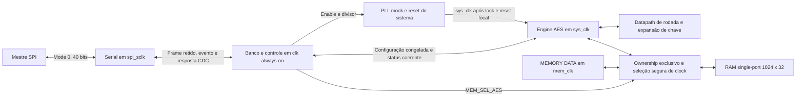

# Arquitetura v1.1 — MiniSoC AES

Data: 29/10/2026. **Proposta revisada para defesa; Semana 2 não aprovada.**
Esta revisão substitui o contrato da [v1.0](arquitetura_v1.0.md), preservada
sem alteração como histórico. Implementação desta entrega: transformações e
rodada combinacional AES; os outros blocos abaixo são planejamento.

## 1. Fontes e classificação

A fonte funcional prioritária é o Block Guide MiniSoC AES v1.0.0, Gabriel
Villanova, setembro/2026, lido integralmente em arquivo local de 15 páginas.
A revisão técnica recebida em 29/10/2026 foi lida como interpretação proposta.
Os dois documentos permanecem fora do Git. O PDF é confidencial; este texto
registra contratos e decisões necessários ao projeto, sem copiar o documento.

R = requisito confirmado na fonte; D = decisão de implementação proposta;
H = hipótese ainda não confirmada; P = questão OPEN. Confirmação de um
requisito não significa aprovação da arquitetura ou validação do RTL.
Os IDs P01–P13 são históricos; os novos itens P14–P27 estão nas
[pendências](../spec/pendencias.md). Os ADRs registram a supersessão das
escolhas antigas, sem apagar suas justificativas.

Referências públicas para o algoritmo: [FIPS 197-upd1](https://nvlpubs.nist.gov/nistpubs/FIPS/NIST.FIPS.197-upd1.pdf)
e [exemplos AES-128 do NIST](https://csrc.nist.gov/CSRC/media/Projects/Cryptographic-Standards-and-Guidelines/documents/examples/AES_Core128.pdf).
FIPS define o algoritmo, não o SPI, a memória ou o escalonamento do MiniSoC.

## 2. Escopo e diagrama

**R:** chave/bloco de 128 bits, cipher e inverse cipher; seis modos;
1..256 blocos; RAM compartilhada 1024 x 32, single-port e in-place.
SPI transporta configuração, comandos e status. Os blocos entram e saem pela
interface externa de memória. Não existem janelas SPI de payload AES.

As setas CDC representam contratos a implementar, não conexões assíncronas
diretas. Seleção segura de clock da RAM ainda requer resposta a P19.

## 3. Top-level e módulos

**R**, Block Guide seção 3, p. 5: o futuro `rtl/minisoc_top.sv` exporá
exatamente estes quatro grupos. Não acrescentar portas de debug, IRQ ou ready.

| Grupo | Entradas | Saídas |
|---|---|---|
| CLK | `clk` (1) | — |
| RESET | `rst_n` (1) | — |
| SPI | `spi_sclk`, `spi_cs_n`, `spi_mosi` (1 cada) | `spi_miso` (1) |
| MEMORY DATA | `mem_clk` (1), `mem_i_data[31:0]`, `mem_i_wr_en` (1), `mem_i_addr[9:0]` | `mem_o_data[31:0]` |

| Arquivo/módulo requerido | Responsabilidade e sinais internos propostos (D) | Situação |
|---|---|---|
| `rtl/minisoc_top.sv` | Integração, resets locais e ownership | Futuro |
| `rtl/minisoc_spi/minisoc_spi.sv` | Pinos SPI; `clk/rst_n`; cfg_key/iv (128), cfg_counter (64), cfg_num_blocks (32 antes de validar), cfg_mode (3), cfg_decrypt (1); controle PLL/owner; leitura de status | Futuro; portas internas não normativas |
| `rtl/minisoc_pll/minisoc_pll_mock.sv` | Referência, enable (1), divisor (2), sys_clk/locked (1 cada) | Futuro, modelo didático |
| `rtl/minisoc_mem/minisoc_memory.sv` | Clock selecionado, addr (10), wdata/rdata (32), we (1), sem reset da RAM | Futuro |
| `rtl/minisoc_aes/minisoc_aes_top.sv` | Configuração capturada, start/busy/done/error, blocks_done (9), porta de memória (10/32/32/1) | Futuro; adaptador CDC interno ou na integração |
| `rtl/minisoc_aes/minisoc_aes_key_exp.sv` | K0..K10 disponíveis para ordem direta/inversa | Semana 4; interface final a definir |
| `rtl/minisoc_aes/minisoc_aes_dp.sv` | Uma rodada combinacional conforme seção 8 | Implementado nesta entrega |
| `rtl/minisoc_aes/aes_transforms_pkg.sv` | Funções puras usadas pelo datapath | Auxiliar implementado, sem portas de topo |

Não foram criados stubs para os blocos futuros; sua presença em tabela não
é evidência de RTL existente. O auxiliar package não altera os nomes requeridos.

## 4. Clocks, reset e CDC

| Clock | R: papel/limite de integração |
|---|---|
| `clk` | Referência de 2 GHz; controle always-on e PLL |
| `spi_sclk` | Serial externo independente, até 25 MHz |
| `sys_clk` | AES após lock; divisores /1, /2, /4, /8 (2 GHz, 1 GHz, 500 MHz, 250 MHz) |
| `mem_clk` | Acesso externo à RAM, até 200 MHz |

**R:** PLL desabilitado mantém clock de sistema bloqueado e locked baixo.
Lock ocorre após espera pseudoaleatória no modelo. O reset global é ativo
baixo e reinicia controle; RAM não é apagada e não possui conteúdo inicial
garantido. O AES permanece em reset até clock liberado e inicialização local.

**D13:** assert assíncrono e deassert sincronizado em cada domínio que tem
estado, com reset local do AES também condicionado à disponibilidade do PLL.
O número de ciclos e a sequência de relock são P20, sem inventar valor oficial.
O banco always-on inicializa sem SCLK e habilita o PLL; isso corrige o antigo
bootstrap que dependia de clocks seriais. O serializador ainda precisa de
reset/framing válido na primeira seleção (P21).

**R:** frame completo cruza de SCLK para `clk` por evento/toggle.
**D14**, protocolo a detalhar e verificar:

1. A 40ª amostra inclui o último bit no frame retido; somente depois publica
   o evento/toggle. Um frame parcial não pode produzir commit.
2. O toggle passa por dois FF receptores em `clk`; comparação com o valor
   anterior detecta um único evento. Após janela de guarda, captura-se o
   barramento retido como uma unidade, sem sincronização individual por bit.
3. A origem preserva o frame até confirmação de captura. Precisam ser
   demonstrados capacidade do slot e tempo até o próximo frame; toggle pode
   perder eventos se alternar duas vezes antes da observação (P22).
4. Banco aplica um único comando completo. Para read, registra uma resposta
   estável; disponibilidade e consumo da resposta cruzam por protocolo
   persistente. SCLK pausável e primeiro bit da resposta são P14.

**D15:** na fronteira `clk`→`sys_clk`, congelar um snapshot de KEY, IV,
COUNTER, MODE, DECRYPT e NUM_BLOCKS antes de publicar pedido persistente.
Sincronizar pedido/ack, capturar configuração após guarda e emitir `start`
local uma vez. Resultado/status devem voltar por snapshot coerente com
confirmação; não sincronizar os nove bits de BLOCKS_DONE separadamente.
Se houver progresso visível durante BUSY, usar snapshots reconhecidos, sem
perder a conclusão quando o clock AES for desabilitado (P23).

Pulsos são locais. Dois FF não provam atomicidade de um barramento. Os
protocolos precisam de estabilidade, limites de atraso/skew, restrições de
clocks, revisão CDC/RDC e orçamento físico. A relação derivada clk/sys_clk
deve ser modelada conforme PLL/divisor; não declarar todos os caminhos
assíncronos por conveniência. Não há análise de metastabilidade/MTBF nesta entrega.

## 5. SPI e mapa

**R**, seções 5–6 do guia: Mode 0, MSB-first; MOSI na subida e MISO na
descida. Frame de 40 bits: `RWb[39]`, `ADDR[38:33]`, `RSV[32]`, `DATA[31:0]`.
RWb=0 escreve, RWb=1 solicita leitura; RSV deve ser 0. Endereços são índices
de registrador de seis bits, sem multiplicação por quatro.

Escrita usa uma transação; leitura usa solicitação e depois retorno com NOP
0x3F. **P14 OPEN:** posição dos 32 bits de resposta, valores dummy, intervalo
entre frames, prontidão e primeiro bit não têm contrato bit a bit completo.
Não reutilizar o snapshot na 16ª borda do protocolo antigo.

| ADDR | Registro | Acesso e campos confirmados (R) |
|---|---|---|
| 0x00..0x03 | KEY0..KEY3 | R/W; fatias 127:96, 95:64, 63:32, 31:0 |
| 0x04..0x07 | IV0..IV3 | R/W; mesma ordem de palavras |
| 0x08 | COUNTER_HI | R/W, contador 63:32 |
| 0x09 | COUNTER_LO | R/W, contador 31:0 |
| 0x0A | NUM_BLOCKS | R/W, valor 1..256 |
| 0x0B | AES_CONTROL | R/W; START[0], DECRYPT[1], MODE[4:2] |
| 0x0C | AES_STATUS | R; BUSY[0], DONE[1], ERROR[2], BLOCKS_DONE[11:3] |
| 0x0D | VERSION | R; constante numérica pendente |
| 0x0E | SYSTEM_CONTROL | R/W; MEM_SEL_AES[0], PLL_ENABLE[1], PLL_DIV_SEL[3:2] |
| 0x0F | SYSTEM_STATUS | R; PLL_LOCKED[0] |
| 0x3F | NOP | Retorno de leitura, sem registrador de payload novo |

**R:** START é write-one-pulse; DONE persiste até novo START válido aceito;
BLOCKS_DONE conta blocos concluídos. MODE=110/111 ou NUM_BLOCKS fora de 1..256
causam ERROR e encerramento sem processamento normal.
**D:** manter NUM_BLOCKS em 32 bits no banco e validar o intervalo antes de
reduzir para nove bits internos; truncar antecipadamente poderia aceitar um
valor inválido como 513 por alias com 1.
**P24:** valores de reset, bits reservados, readback de START, ERROR e
acessos inválidos. **P25:** comandos/escritas simultâneos com BUSY ou conclusão.
Não há VALID_MASK, DATA_IN/DATA_OUT, CLR_DONE ou CLR_ERROR oficiais.

## 6. Memória, ownership e processamento in-place

**R:** bloco B ocupa palavras 4B..4B+3; palavra 0 é `[127:96]`, depois
`[95:64]`, `[63:32]`, `[31:0]`. N=256 usa até endereço 1023.
Usar índice de bloco de nove bits para representar 256 em contagens;
o endereço físico continua com dez bits. Não truncar NUM_BLOCKS para oito bits.

**R:** MEM_SEL_AES=0 seleciona clock/endereço/dados/we externos; =1 seleciona
o AES. Há um recurso físico de porta única. Trocar posse requer AES ocioso e
nenhuma operação externa em andamento. Leitura e escrita são síncronas ao
clock selecionado; a latência exata de leitura é P18.

**D16:** propor sequência de handoff: interromper novos acessos na origem,
confirmar ausência de operação pendente, desabilitar a origem antiga de clock,
trocar owner por mecanismo seguro e só então habilitar o novo acesso.
**P19 OPEN:** a interface externa não possui ready/valid/idle; `mem_i_wr_en=0`
também representa leitura, não ociosidade. A condição de inatividade e o
mecanismo de mux de clock precisam de acordo com instrutor/DV. Não implementar
`assign ram_clk = sel ? sys_clk : mem_clk` como solução segura.

**R/D:** após START válido, capturar configuração; por bloco, buscar quatro
palavras, guardar o bloco original, aplicar o modo e a primitiva, escrever quatro
palavras nos mesmos endereços e só então incrementar BLOCKS_DONE. Preservar
ciphertext de entrada para CBC/CFB decrypt e entrada/saída para PCBC antes da
sobrescrita. Após N blocos, publicar conclusão coerente. Reset pode interromper
uma escrita parcial; RAM persiste e software deve recarregar dados antes de
repetir, sem alegar rollback/atomicidade do bloco (P26).

## 7. Modos e engine futuro

**R:** MODE 000 ECB, 001 CBC, 010 PCBC, 011 CFB, 100 OFB, 101 CTR.
O guia fixa os modos e descreve o comportamento; as equações abaixo são
**D17**, interpretação de implementação a confrontar com o IP de referência.
`E/D` são primitivas AES, P/C são plaintext/ciphertext e Q começa no IV.

| Modo | Cifragem | Decifragem e atualização |
|---|---|---|
| ECB | C=E(P) | P=D(C) |
| CBC | C=E(P xor Q); Q=C | P=D(C) xor Q; Q=C original |
| PCBC | C=E(P xor Q); Q=P xor C | P=D(C) xor Q; Q=P xor C original |
| CFB | stream=E(Q); C=P xor stream | P=C xor E(Q); feedback ciphertext; segmento P15 |
| OFB | Q=E(Q); saída=entrada xor Q | Mesma primitiva encrypt nos dois sentidos |
| CTR | stream=E(IV xor zero_extend_128(counter64)); saída=entrada xor stream | Mesma primitiva encrypt; incremento por bloco |

A expressão CTR por XOR é **R** explícito; não substituir por concatenação
IV||counter. **P16:** overflow e instante do incremento. **H:** CFB-128 é
possível, mas não adotado como requisito enquanto P15 não for respondido.
**P17:** confirmar comportamento de DECRYPT nos modos de fluxo e feedback CFB.

**D18:** manter proposta iterativa com uma unidade de rodada reutilizada;
registradores e enables ficarão no controlador da Semana 4. Propor pré-expansão
de K0..K10 para leitura direta/inversa; são 11 x 128 bits lógicos, sem estimativa
de área física. Comparar com geração reversível antes de congelar. A geração
adiantada antiga e a contagem de 16+4 S-boxes não ficam automaticamente mantidas.

Não aplicar cronograma E0–E12 da v1.0 ao MiniSoC. Leitura de RAM, expansão,
modo, rodada, escrita, CDC e status têm custos a medir. Frequências do PLL são
cenários do modelo, não fmax comprovado do datapath.

## 8. Interface implementada na Semana 3 (D19)

O datapath é combinacional; controlador futuro retém State e fornece chave
da rodada. Não há clock/reset/start/busy dentro deste módulo.

| Porta | Direção/largura | Contrato |
|---|---|---|
| state_i | Entrada 128 | Byte i em `[127-8*i -: 8]`; State por colunas |
| round_key_i | Entrada 128 | K0/K1..K10 forward, K10/K9..K0 inverse |
| decrypt_i | Entrada 1 | 0 CIPHER; 1 INVCIPHER padrão |
| initial_round_i | Entrada 1 | Apenas AddRoundKey; tem prioridade sobre final |
| final_round_i | Entrada 1 | Suprime MixColumns/InvMixColumns |
| state_o | Saída 128 | Resultado combinacional, sem retenção |

Forward normal: SubBytes → ShiftRows → MixColumns → AddRoundKey.
Inverse normal: InvShiftRows → InvSubBytes → AddRoundKey → InvMixColumns.
Final omite a mistura; inicial faz XOR com K0 (encrypt) ou K10 (decrypt).
Chaves inversas são normais, sem InvMixColumns na chave; não misturar este
contrato com EQINVCIPHER. O package separa sete transformações em funções
automáticas com laços de limites fixos e tabelas case completas.

O RTL não tem delays, inicialização de memória, latch ou controle sequencial.
Lint/elaboração e testes não substituem síntese mapeada/STA. O TB reutiliza o
datapath por dez rodadas com chaves fornecidas como constantes públicas;
isso não implementa Key Expansion ou FSM dentro do RTL.

## 9. Riscos, evidências e aceite

| Risco | Evidência/ação necessária |
|---|---|
| Transposição do State ou ordem inversa da chave | Vetores por transformação, estados intermediários e KATs |
| Perda/duplicação de frame CDC | Slot retido, ack e testes de clocks pausados/back-to-back |
| Status incoerente entre domínios | Snapshot de progresso e conclusão com confirmação |
| Glitch na seleção da RAM/PLL | Contrato de idle, mecanismo aprovado e análise de clock |
| Reset/relock produzir evento fantasma | Reset coordenado de toggles e teste em cada fase |
| In-place destruir feedback | Guardar entradas necessárias antes de escrever |
| Caminho combinacional não atingir frequência | Síntese/STA com tecnologia e restrições reais |
| Documentação histórica ser tratada como vigente | Índices e avisos de supersessão com links v1.1 |

Evidências e checklist de defesa estão no [relatório de retomada](../reports/semana_02_retomada.md).
Testes reais e limites estão no [relatório da Semana 3](../reports/semana_03.md).
Aceite do parceiro e instrutor continua pendente; não há síntese física,
fechamento de timing/CDC, potência, UPF ou MTBF demonstrados.
