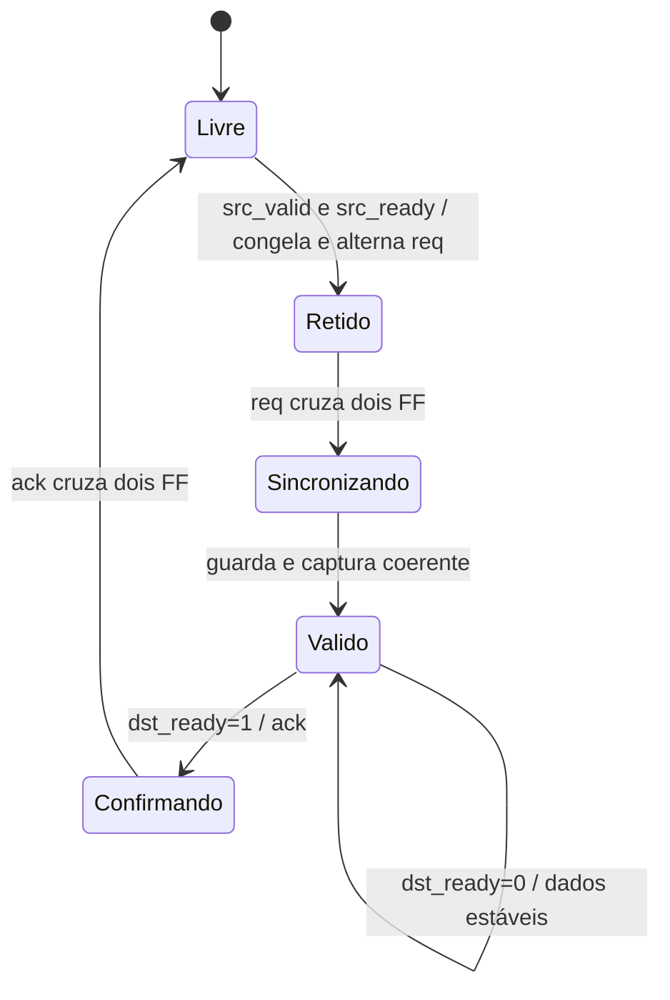

# Contrato interno da Semana 5 — SPI, banco e snapshots CDC

Data: 18/11/2026. **D21–D24 são escolhas provisórias implementadas e testadas.**
Complementa a [arquitetura v1.1](arquitetura_v1.1.md), sem alterar seu texto
ou encerrar P14/P20/P21/P22/P23/P24/P25. A revisão do instrutor continua
necessária. Não há integração com AES, RAM ou PLL nesta entrega.

## Requisitos confirmados e interfaces internas

SPI Slave Mode 0, CPOL=0, CPHA=0, MSB-first, CS baixo. MOSI é amostrado na
subida; MISO muda na descida. Cada comando contém exatamente 40 amostras:
`{RWb[39], ADDR[38:33], RSV[32], DATA[31:0]}`. RWb=0 escreve, RWb=1 solicita
leitura; RSV=0. ADDR indexa palavras do mapa, sem deslocamento de bytes.
SCLK externo até 25 MHz; `clk` é independente e always-on.

As portas abaixo são auxiliares, não portas novas do futuro `minisoc_top`:

| Módulo/porta | Semântica local |
|---|---|
| `minisoc_spi`: clk/rst_n/SPI | Periférico completo desta etapa; rst_n global baixo |
| `cfg_valid_o/cfg_ready_i/cfg_o[355:0]` | Snapshot em clk; válido permanece até handshake |
| `status_valid_i/status_i[11:0]` | Snapshot já síncrono a clk; banco consome a cada valid, sem backpressure |
| `pll_locked_i` | Já síncrono a clk; não ligar sinal assíncrono diretamente |
| mem_sel_aes_o/pll_enable_o/pll_div_sel_o | Bits armazenados de SYSTEM_CONTROL; não geram/multiplexam clocks |
| overrun_o | Diagnóstico interno sticky sincronizado a clk, limpo por reset |
| command_reject_o | Pulso interno em clk para frame longo ou comando rejeitado; não é registro SPI/IRQ |
| `minisoc_aes_cdc` | Adaptador independente entre clk e futuro sys_clk |
| cfg_valid_i/cfg_ready_o/cfg_i | Origem em clk do adaptador |
| cfg_valid_o/cfg_ready_i/cfg_o | Destino em sys_clk; consumo gera um único START local no futuro engine |
| status_valid_i/status_ready_o/status_i | Origem em sys_clk; produtor mantém valid/data até ready |
| status_valid_o/status_ready_i/status_o | Destino em clk; conectar ready=1 ao banco na integração |

O snapshot de configuração tem 356 bits:

| Fatia | Campo |
|---|---|
| 355:228 | KEY[127:0] |
| 227:100 | IV[127:0] |
| 99:36 | COUNTER[63:0] |
| 35:4 | NUM_BLOCKS[31:0], antes de qualquer redução |
| 3:1 | MODE[2:0] |
| 0 | DECRYPT |

Status mantém o mesmo empacotamento do mapa: BUSY[0], DONE[1], ERROR[2],
BLOCKS_DONE[11:3]. O adaptador não interpreta os 12 bits, apenas transporta.

## D21 — reset e framing

`minisoc_reset_sync` afirma reset assincronamente e libera após duas subidas
do clock local. Um domínio parado permanece em reset. Os dois FF estão
marcados ASYNC_REG; isso é intenção para implementação, não prova física.

**Preparação provisória do mestre:** após reset, manter CS alto e fornecer
duas subidas de SCLK antes da primeira transação. O banco em clk inicializa
mesmo sem SCLK e deixa PLL_ENABLE=1. Os testes também afirmam reset com
SCLK parado; não pressupõem clocks contínuos para sair de reset. Se o mestre
selecionar antes dessa preparação, os primeiros bits podem ser descartados:
esse primeiro frame não tem garantia de aceitação. P21 precisa definir a
sequência oficial. Depois da preparação, a próxima transação completa funciona.

CS limpa assincronamente apenas contador/shift de recepção e shift/MISO de
transmissão, através de `frame_rst_n = spi_rst_n && !spi_cs_n`. Nunca limpa
mailbox, toggle ou resposta pendente. A retirada desse reset de framing em
CS baixo depende do setup/recovery/removal entre CS e a primeira borda SCLK;
não se aplicam duas bordas de atraso a cada seleção. Valores elétricos e
restrições finais de CS continuam sujeitos à revisão física/P21.

Reset global coordenado limpa req, ack, snapshots, banco e resposta. Cancela
operações pendentes, sem rollback de comandos já aplicados antes do reset.
Reset independente de apenas um lado de mailbox não é suportado. A futura
sequência PLL/relock e reset AES local exige projeto adicional conforme P20.

## D22 — fechamento do frame e resposta SPI

O contador de seis bits satura em 41. Na 40ª subida, se o slot está livre,
inclui-se o último bit em hold_q e alterna-se req. Na 41ª, long_q marca o
mesmo candidato como inválido. Frames de 0..39 bits não publicam pedido.

Para distinguir 40 de 41+ bits sem exigir uma borda SCLK após CS alto, o
destino **não aplica o candidato imediatamente na 40ª subida**. Sincroniza
req e CS, faz guarda, exige três observações de CS alto e então captura
hold_q/long_q. Isso refina a proposta D14 da v1.1; não muda o formato R do frame.
O dado e sua marca de comprimento permanecem retidos até ack, inclusive com
SCLK parado. Truncamentos não produzem pulso de diagnóstico porque não
publicam candidato algum; frames longos produzem command_reject_o.

**Contrato provisório suportado:** CS deve ficar alto por pelo menos
12 ciclos **em execução** de clk entre frames; isso inclui tempo para aplicar
o comando no banco. É uma margem conservadora do pipeline atual, não número
do Block Guide nem limite físico comprovado. Também respeitar setup/hold de
SPI. Um intervalo em nanossegundos não substitui ciclos se clk estiver parado.
Não há promessa de aceitar CS alto arbitrariamente curto. A P14/P22 permanece OPEN.

Há somente um slot. No fim de outro frame com slot ocupado, req não alterna,
hold_q não muda e overrun fica 1 até reset. O segundo comando é descartado;
não existe FIFO ou pino ready. Portanto não se promete entrega ilimitada com
clk parado: a proteção demonstrada é retenção do primeiro, ausência de
sobrescrita/duplicação e diagnóstico do excesso. Sem o limite de um pedido
pendente, duas alternâncias poderiam se cancelar antes de serem vistas.

Resposta **provisória P14**, explicitamente testada como D22:

1. Read válido em clk captura um snapshot de 32 bits e seta pending.
2. SCLK pode parar indefinidamente; response_q permanece estável.
3. Mestre envia NOP **de escrita**: `{1'b0,6'h3f,1'b0,32'b0}`.
4. MISO devolve `{8'h00, DATA[31:0]}`. Primeiro bit de DATA é a 9ª amostra.
   Na descida após a 8ª amostra, o header 0x7e seleciona a resposta retida.
   As oito primeiras amostras são zero, sem necessidade de pré-carregar um
   primeiro bit diferente de zero antes da primeira subida.
5. Pending cruza por três FF; response_q cruza como barramento retido com
   guarda até a descida 8. Não há dois FF em cada bit de DATA.
6. Somente NOP completo, RSV=0, de escrita, aceito no banco, confirma consumo.
   NOP truncado/longo não consome; o mestre pode tentar novamente.
7. Read consecutivo enquanto pending é rejeitado sem substituir a resposta.
   Escritas comuns continuam possíveis; não alteram o snapshot já capturado.
8. Sem resposta, MISO=0. Com CS alto, MISO=0 (sem tristate neste módulo).

A escolha de dummy, posição DATA, MISO deselecionado, latência, NOP/RWb e
política de reads não fecha P14. Um driver definitivo depende dessa resposta.

## Mapa e D24 — banco/políticas ainda não oficiais

| Índice | Nome | Conteúdo implementado |
|---|---|---|
| 00–03 | KEY0–3 | R/W; 127:96 até 31:0 |
| 04–07 | IV0–3 | R/W; mesma ordem |
| 08/09 | COUNTER_HI/LO | R/W; 63:32 e 31:0 |
| 0A | NUM_BLOCKS | R/W; 32 bits preservados |
| 0B | AES_CONTROL | R/W; START[0], DECRYPT[1], MODE[4:2] |
| 0C | AES_STATUS | R; BUSY[0], DONE[1], ERROR[2], BLOCKS_DONE[11:3] |
| 0D | VERSION | R; parâmetro VERSION_VALUE, placeholder default 0 |
| 0E | SYSTEM_CONTROL | R/W; MEM_SEL_AES[0], PLL_ENABLE[1], PLL_DIV_SEL[3:2] |
| 0F | SYSTEM_STATUS | R; PLL_LOCKED[0] |
| 3F | NOP | Sem armazenamento; confirma resposta na forma D22 |

R: modos 0=ECB, 1=CBC, 2=PCBC, 3=CFB, 4=OFB, 5=CTR; 6/7 inválidos.
START válido exige NUM_BLOCKS completo entre 1 e 256 e modo <=5; gera um
único snapshot, seta BUSY e limpa DONE/ERROR/BLOCKS_DONE. Os algoritmos de
modo e o processamento dos blocos não são implementados neste periférico.
DONE persiste até novo START válido aceito, como exige a v1.1.

| Política D24 | Comportamento local, sujeito a P24/P25 |
|---|---|
| Reset | KEY/IV/COUNTER/N/controles AES/status/resposta/snapshot=0; SYSTEM_CONTROL=2 |
| VERSION | Default 0 é marcador de valor não definido; não identifica versão aprovada |
| Reservados | Escritas ignoram bits reservados dos controles; leituras retornam zero |
| START readback | Sempre zero; comando não é armazenado |
| START inválido | Seta ERROR, não despacha; preserva DONE/contagem anteriores |
| ERROR | Sticky; limpa somente em reset ou START válido aceito |
| START ocupado | Rejeita sem fila; bits de MODE/DECRYPT do banco ainda são escritos |
| Escritas com BUSY | Banco aceita configurações; snapshot em execução fica congelado |
| Status | Só considera status_valid enquanto BUSY; DONE/ERROR acumulam; contagem vem do snapshot |
| Conclusão x START | Status tem prioridade; START simultâneo é rejeitado |
| Status idle não solicitado | Ignorado; engine deve publicar terminal DONE/ERROR antes de encerrar |
| RO/RSV/endereço inválido | Rejeita sem alteração de registro e sem criar código de erro SPI no mapa |
| Controle de sistema com BUSY | Bits podem mudar; segurança de owner/clock não implementada, bloqueada por P19/P20/P25 |

Não existem CLR_DONE, CLR_ERROR, VALID_MASK, DATA_IN ou DATA_OUT novos.
Diagnósticos são internos e não alteram as portas oficiais do MiniSoC.

## D23 — mailboxes e futuras conexões

`minisoc_cdc_mailbox` usa hold_q, req, ack e dois FF para cada toggle. Ready
na origem só sobe fora de reset e quando req=ack sincronizado. Aceitar
valid&&ready congela DATA e alterna req. O destino aguarda sincronização e
um ciclo de guarda, captura o vetor inteiro e mantém valid/data até ready.
Somente o consumo confirma ack. A origem não pode gerar segundo evento
antes disso. Não há contagem por pulsos, nem captura bit a bit do vetor.

O adaptador tem duas instâncias: configuração de 356 bits clk→sys_clk e
status de 12 bits sys_clk→clk. O futuro engine deverá consumir configuração
uma vez, gerar START local de um ciclo e publicar snapshots de progresso e
conclusão com valid/ready. Deve manter o domínio vivo até confirmação de
status, principalmente a conclusão (P23). O banco pode ser testado por
estímulos síncronos; o TB do adaptador compara filas nos dois sentidos. Não
há módulo que simule integração completa com AES nesta entrega.

## Limites físicos e revisão necessária

| Travessia | Retenção/guarda RTL | Trabalho físico restante |
|---|---|---|
| hold_q/long_q SCLK→clk | Slot até ack; req sincronizado, guarda e qualificação CS | Max delay/skew, colocação de FF e CDC/RDC |
| response_q clk→SCLK descida 8 | Pending até NOP; três FF e prefixo de oito clocks | Orçamento de meia borda, SCLK/CS IO timing |
| Config/status nas mailboxes | Snapshot até consumo; dois FF, guarda | Restrições bundled-data e metastabilidade/MTBF |
| Reset/framing | Assert assíncrono; release local e CS com setup | Recovery/removal, árvore de reset, P20/P21 |

Síntese genérica não comprova timing a 25 MHz/2 GHz, CDC físico, MTBF, área
de silício, segurança de mux da RAM ou potência. A relação clk/sys_clk precisa
ser modelada conforme a futura PLL; não declarar todos os caminhos falsos.
O [relatório](../reports/semana_05.md) contém execuções e critérios de aceite.
